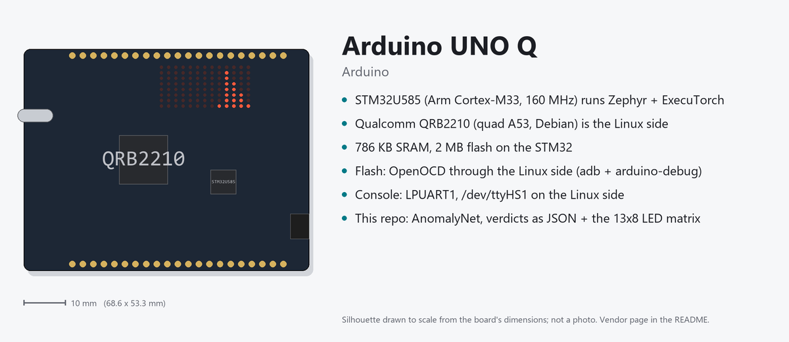
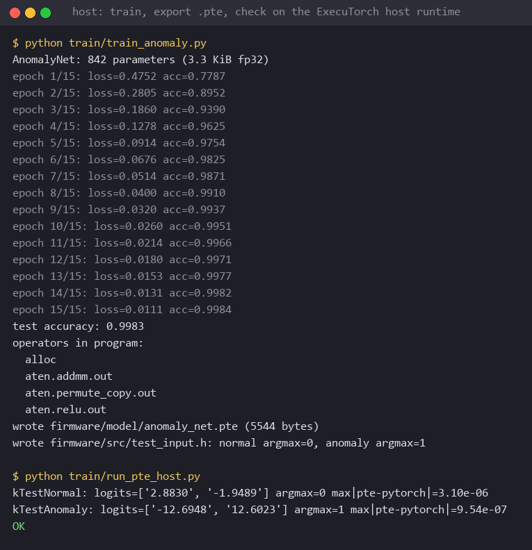
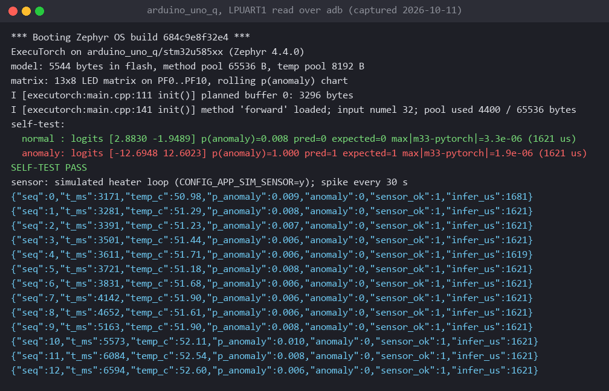
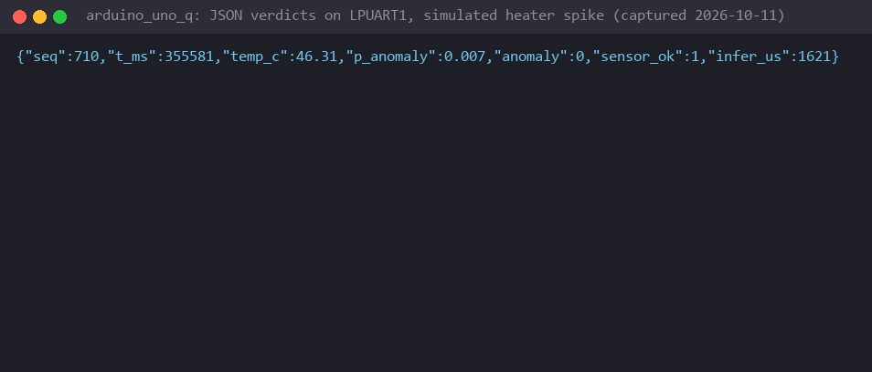

# ExecuTorch anomaly detection on the Arduino UNO Q (STM32 brain, Zephyr)

The Arduino UNO Q has two brains: an **STM32U585** (Cortex-M33) and a **Qualcomm QRB2210**
running Debian. This repo puts a tiny PyTorch anomaly classifier on the STM32 under **Zephyr**
with the [ExecuTorch Zephyr module](https://docs.zephyrproject.org/latest/develop/manifest/external/executorch.html),
and hands the verdicts to the Linux side as JSON lines over the internal UART.



It is the follow-on to my Edge Impulse post
[AI for Industrial Control Systems: Bringing Edge AI to PLCs](https://www.edgeimpulse.com/blog/transform-industrial-control-systems-with-ai-anomaly-detection-made-easy/),
where an anomaly detector on an Arduino Opta watched a temperature loop and could trip a machine
in under 20 ms. Same shape of problem here, but the split is explicit: the microcontroller owns
the real-time loop and the decision, and the Linux side does the things a Linux box is good at
(logging, MQTT, dashboards, cameras, cloud) without ever being in the control path.

```
            STM32U585 (Zephyr)                              QRB2210 (Debian)
 A0 ──ADC──▶ 32-sample window ──ExecuTorch──▶ p(anomaly) ──LPUART1 JSON──▶ linux/anomaly_bridge.py
                                            ├─▶ RGB LED 3 green/red                   └─▶ CSV log, on_alarm()
                                            └─▶ 13x8 LED matrix: rolling p(anomaly) chart
```

The MCU samples at 10 Hz, runs the model every 500 ms in tens of microseconds, drives the RGB
LED, draws a rolling probability chart on the 13x8 LED matrix and prints one JSON object per
inference. If the Linux side is asleep, rebooting or busy, the loop
does not care.

## In pictures

Training and export on the host, then the exported `.pte` checked against PyTorch with the
ExecuTorch host runtime:



The same `.pte` running on the STM32 (self-test against the PyTorch logits, then live
inference), read on the Linux side:





## What is in the repo

| Piece | Where | Notes |
|---|---|---|
| Model + synthetic data | `train/model.py`, `train/train_anomaly.py` | 842-parameter MLP over 32 temperature samples, `normal`/`anomaly` |
| Export to `.pte` | `train/train_anomaly.py` | `to_edge_transform_and_lower`, portable fp32 ops (`addmm`, `relu`) |
| Host check | `train/run_pte_host.py` | runs the `.pte` with the ExecuTorch Python runtime |
| MCU firmware | `firmware/` | Zephyr app for `arduino_uno_q/stm32u585xx`, ADC or simulated sensor |
| LED matrix | `firmware/src/matrix.c`, `firmware/drivers/` | rolling p(anomaly) chart on the 13x8 charlieplexed matrix; driver vendored from Zephyr main |
| Flash helper | `firmware/scripts/flash_unoq.py` | adb + the board's OpenOCD + gdb, since `west flash` is not wired up |
| Extending | `docs/extending.md` | analog sensors on A0 to A5, Modulino nodes on the Qwiic connector |
| Linux brain | `linux/anomaly_bridge.py` | parses the JSON stream, logs CSV, fires `on_alarm()` |
| Manifest | `west.yml` | Zephyr v4.4.0 (+ `hal_stm32`, CMSIS) and ExecuTorch v1.5.1 as a module |
| CI | `.github/workflows/build.yml` | trains, exports, checks on host, builds both firmware variants |

`firmware/model/anomaly_net.pte` and `firmware/src/test_input.h` are committed. Training is
seeded, so a re-run produces a byte-identical `.pte`; CI regenerates them on every push to `main`
and commits only if they changed.

## Hardware

- Arduino UNO Q. Target `arduino_uno_q/stm32u585xx`.
- Optional: a TMP36 (or any analog temperature sensor) on **A0**. With nothing wired, leave
  `CONFIG_APP_SIM_SENSOR=y` (default): the firmware simulates a heater loop and injects a spike
  every 30 s so both classes show up.
- USB-C to the host for `adb`. The Linux side bridges SWD to the STM32, so no debug probe.
- The 13x8 LED matrix shows the last 13 inferences as a bar chart: column height is p(anomaly),
  dim is normal, bright is an anomaly, dotted means the sensor read out of range. A tick after
  the self-test passes, a cross if it fails. `CONFIG_APP_LED_MATRIX=n` turns it off.

## Quick start

### 1. Host setup

```bash
python3 -m venv .venv && source .venv/bin/activate
pip install -r requirements.txt --extra-index-url https://download.pytorch.org/whl/cpu
```

On Windows the ExecuTorch wheel does not pull in `torch`; add
`pip install torch --index-url https://download.pytorch.org/whl/cpu`.

### 2. Train and export

```bash
python train/train_anomaly.py      # ~30 s on CPU, synthetic data
python train/run_pte_host.py       # host check: .pte matches PyTorch within 1e-3
```

Normal data is a 60 s heater cycle around 50 C with 0.3 C noise; anomalies are spikes, sensor
dropouts, thermal runaway and noise bursts. Replace `make_dataset` with recordings from A0 when
you have them.

### 3. Zephyr workspace

```bash
west init -m https://github.com/eoinjordan/executorch-zephyr-arduino-uno-q ws
cd ws
west update --narrow -o=--depth=1
west packages pip --install
west sdk install --toolchains arm-zephyr-eabi
```

### 4. Build

```bash
west build -p always -b arduino_uno_q/stm32u585xx executorch-zephyr-arduino-uno-q/firmware
```

For a real sensor on A0: `west build ... -- -DCONFIG_APP_SIM_SENSOR=n`. `CONFIG_APP_MV_PER_DEGREE`
and `CONFIG_APP_MV_OFFSET` default to a TMP36 (10 mV/C, 500 mV at 0 C).

### 5. Flash through the Linux side

The QRB2210 runs OpenOCD and bit-bangs SWD to the STM32. The helper forwards the gdb port over
`adb`, starts `arduino-debug` on the board, loads the ELF and resets:

```bash
python executorch-zephyr-arduino-uno-q/firmware/scripts/flash_unoq.py --elf build/zephyr/zephyr.elf
```

By hand it is `adb forward tcp:3333 tcp:3333 && adb shell arduino-debug` in one terminal and
`west debug -r openocd` (then `load`, `monitor reset run`) in another.

### 6. Watch both brains

The Zephyr console goes to **LPUART1**, the UART that links the STM32 to the QRB2210. On the
Linux side that is `/dev/ttyHS1`. The stock `arduino-router` service holds that port for the
Arduino App Lab bridge firmware, so stop it first (and start it again when you want App Lab back):

```bash
adb shell sudo systemctl stop arduino-router-serial.path arduino-router-serial arduino-router
```

Then either run the bridge on the board:

```bash
adb shell
pip install pyserial
python3 anomaly_bridge.py --port /dev/ttyHS1 --log anomalies.csv
```

or pipe the UART to your PC over adb, no pyserial needed:

```bash
adb exec-out cat /dev/ttyHS1 | python linux/anomaly_bridge.py --port - --log anomalies.csv
```

Expected output:

```
[mcu] ExecuTorch on arduino_uno_q/stm32u585xx (Zephyr 4.4.0)
[mcu] self-test:
[mcu]   normal : logits [ ... ] p(anomaly)=0.0xx pred=0 expected=0 max|m33-pytorch|=...e-07 (... us)
[mcu]   anomaly: logits [ ... ] p(anomaly)=0.9xx pred=1 expected=1 max|m33-pytorch|=...e-07 (... us)
[mcu] SELF-TEST PASS
normal   temp= 52.31 C  p=0.012  41 us
...
ANOMALY  temp= 70.12 C  p=0.994  41 us
*** ALARM at seq 52: temp 70.12 C, p=0.994
```

## Verify

1. **Export is faithful.** `python train/run_pte_host.py` asserts the `.pte` reproduces the PyTorch
   logits for the embedded windows within 1e-3.
2. **Firmware builds.** CI builds the simulated and ADC variants for `arduino_uno_q/stm32u585xx`.
3. **Device agrees with the host.** The console shows `SELF-TEST PASS` and the LED matrix shows
   a tick: the M33 reproduces the PyTorch logits for both embedded windows.
4. **Linux brain receives.** `anomaly_bridge.py` prints `ANOMALY` and `*** ALARM` once every 30 s
   in simulated mode and `anomalies.csv` grows.

## The JSON contract

One object per line, nothing else on the line:

```json
{"seq":12,"t_ms":6500,"temp_c":52.31,"p_anomaly":0.012,"anomaly":0,"sensor_ok":1,"infer_us":41}
```

`anomaly` is already thresholded on the MCU (`CONFIG_APP_ANOMALY_THRESHOLD_PERCENT`, default 80)
and also set when the sensor reads out of range, so the Linux side can act on it without
re-implementing policy. `p_anomaly` is there for dashboards and tuning.

## Firmware notes

- Same structure as the `zephyr/samples/hello-executorch` sample in the ExecuTorch repo:
  `CONFIG_EXECUTORCH=y` pulls the module in, the selective build links only the operators in the
  `.pte`, and the model is embedded in `.rodata`. The Cortex-M (CMSIS-NN) kernels are registered
  so an int8 export drops in later.
- The board file puts the console on USART1, which is the header serial (D0/D1).
  `firmware/app.overlay` moves it to LPUART1 so the JSON reaches the Linux side.
- The `charlieplex-led-matrix` display driver landed in Zephyr after v4.4.0, so it is vendored
  under `firmware/drivers/` with its binding in `firmware/dts/`. The devicetree node in
  `app.overlay` is the upstream one (PF0 to PF10, TIM17 as the scan clock, 3-bit grayscale).
  Delete both directories once the manifest moves to a release that has the driver.
- `firmware/CMakeLists.txt` orders the ExecuTorch runtime after Zephyr's generated headers;
  without that a parallel build can race and fail on `zephyr/heap_constants.h`.
- Windows host: `west sdk install` needs 7-Zip on `PATH`, and pass
  `-DFLATC_EXECUTABLE=<venv>/Scripts/flatc.exe` to `west build` (the ExecuTorch wheel ships it)
  because building `flatc` from source under Ninja fails there.

## Going further

- **Other sensors**: [docs/extending.md](docs/extending.md) walks through analog inputs on A0 to
  A5 and Modulino nodes on the Qwiic connector (I2C4), with overlay snippets and the two places
  in the code that change.
- **Quantise** with PT2E int8 and the Cortex-M partitioner.
- **Replace the UART with SPI** to the QRB2210 for higher-rate telemetry.
- **Do something on Linux**: swap `on_alarm()` for an MQTT publish or a camera snapshot.
- **Accelerators**: the ExecuTorch Arm backend targets Ethos-U; the Corstone-320 FVP under
  Zephyr is the cheapest place to try the same `.pte` with an NPU.

## Further reading

- [AI for Industrial Control Systems: Bringing Edge AI to PLCs](https://www.edgeimpulse.com/blog/transform-industrial-control-systems-with-ai-anomaly-detection-made-easy/),
  the Opta write-up this example grew out of.
- [The Edge Impulse guest edition of Elektor (Elektor 469)](https://www.elektormagazine.com/elektor-edge-impulse),
  which carries my article on edge AI anomaly detection for industrial control.
- [Zephyr: Arduino UNO Q board page](https://docs.zephyrproject.org/latest/boards/arduino/uno_q/doc/index.html)
- [ExecuTorch as a Zephyr module](https://docs.zephyrproject.org/latest/develop/manifest/external/executorch.html)

## License

Apache-2.0. See [LICENSE](LICENSE).
